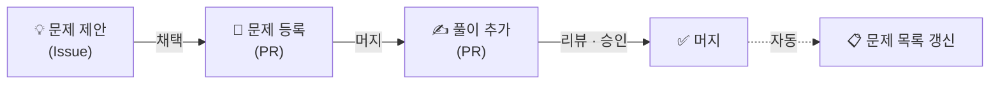

# 기여 가이드

이 저장소에 기여하는 방법을 한 페이지로 정리한 **요약본**입니다. 단계별 자세한 설명은 각 링크를 따라가세요.

## 전체 흐름

| 단계 | 누가 | 무엇을 | 가이드 |
|---|---|---|---|
| 1. 제안 | 누구나 | `문제 제안` 템플릿으로 이슈 작성 | [01](docs/01-propose-problem.md) |
| 2. 채택 | 운영진 (👍 3개 이상이면 채택) | 이슈에 `채택` 라벨 부착 | [01](docs/01-propose-problem.md) |
| 3. 등록 | 제안자 또는 지원자 | `new_problem.py --issue` 로 문제 폴더를 만들어 PR | [01](docs/01-propose-problem.md) |
| 4. 풀이 | 누구나, 언제든 | `new_solution.py` 로 풀이 파일을 만들어 PR | [02](docs/02-submit-solution.md) |
| 5. 리뷰 | 누구나 (승인 1개 필요) | 코드 리뷰, Approve | [03](docs/03-code-review.md) |
| 6. 머지 | **PR 작성자 본인** | 승인 + 자동 검사 통과 후 Squash and merge | [02](docs/02-submit-solution.md) |

## 꼭 지킬 규칙

1. **`main` 에 직접 푸시하지 않습니다.** 모든 변경은 브랜치 → PR 로 올립니다.
2. **풀이는 파이썬(`.py`)만** 받습니다.
3. **문제 원문을 복사하지 않습니다.** 링크와 직접 쓴 요약만 올립니다.
4. **PR 1개 = 문제 1개.** 여러 문제를 한 PR 에 섞지 않습니다.
5. **승인 1개 + 자동 검사 통과** 후 작성자가 직접 머지합니다.
6. **기브 앤 테이크**: PR 을 1개 올렸다면 다른 사람 PR 도 1개 리뷰해 주세요.

> [!NOTE]
> 폴더 이름, 파일 이름, 브랜치 이름 규칙은 **스크립트가 알아서 맞춰줍니다.** 외울 필요는 없고, 궁금하면 [04. 폴더 구조와 네이밍](docs/04-directory-structure.md) 을 보세요.
> 전체 문제 목록(`PROBLEMS.md`)도 머지되면 자동으로 갱신되니 직접 만들지 않습니다.

## 제목 규칙 (이슈 · PR · 커밋 공통)

모두 **`[말머리] 문제 이름 또는 한 줄 요약`** 형식입니다. 플랫폼·번호는 적지 않아도 됩니다.

| 말머리 | 언제 | 예시 |
|---|---|---|
| `[제안]` | 문제 제안 이슈 | `[제안] 같은 숫자는 싫어` |
| `[질문]` | 질문 이슈 | `[질문] 같은 숫자는 싫어 시간 초과` |
| `[문제]` | 문제 등록/수정 | `[문제] 같은 숫자는 싫어` |
| `[풀이]` | 풀이 추가/수정 | `[풀이] 같은 숫자는 싫어`, `[풀이] 리뷰 반영 - 변수명 정리` |
| `[문서]` | README, docs 수정 | `[문서] 리뷰 가이드에 예시 추가` |
| `[개선]` | 스크립트, 템플릿, 설정 | `[개선] validate.py 에 경고 추가` |

> [!TIP]
> 커밋 메시지를 이 형식으로 쓰면 PR 을 만들 때 제목이 자동으로 채워집니다.

## 스크립트

Python 3.9+ 표준 라이브러리만 쓰므로 따로 설치할 것이 없습니다. (Windows 에서 `python` 이 안 되면 `py` 로 실행)

| 명령 | 하는 일 |
|---|---|
| `python scripts/new_problem.py --issue <번호>` | 제안 이슈의 정보로 문제 폴더 만들기 |
| `python scripts/new_solution.py <문제 이름 일부>` | 문제 검색 → 작업 브랜치 생성 → 내 풀이 파일 만들기 |
| `python scripts/validate.py` | 폴더·파일 규칙 검사 (PR 올리기 전에!) |
| `python scripts/build_index.py` | 문제 목록 미리 보기 (로컬 전용) |

## 행동 강령

- 리뷰는 **사람이 아니라 코드**에 대해 합니다.
- "왜 이렇게 짰어요?" 대신 "이 부분은 어떤 의도인지 궁금해요!" 처럼 말해 주세요.
- 어떤 질문도 환영합니다.
- 다른 사람의 풀이를 자기 이름으로 올리지 않습니다. 참고했다면 헤더에 출처를 적어주세요.
